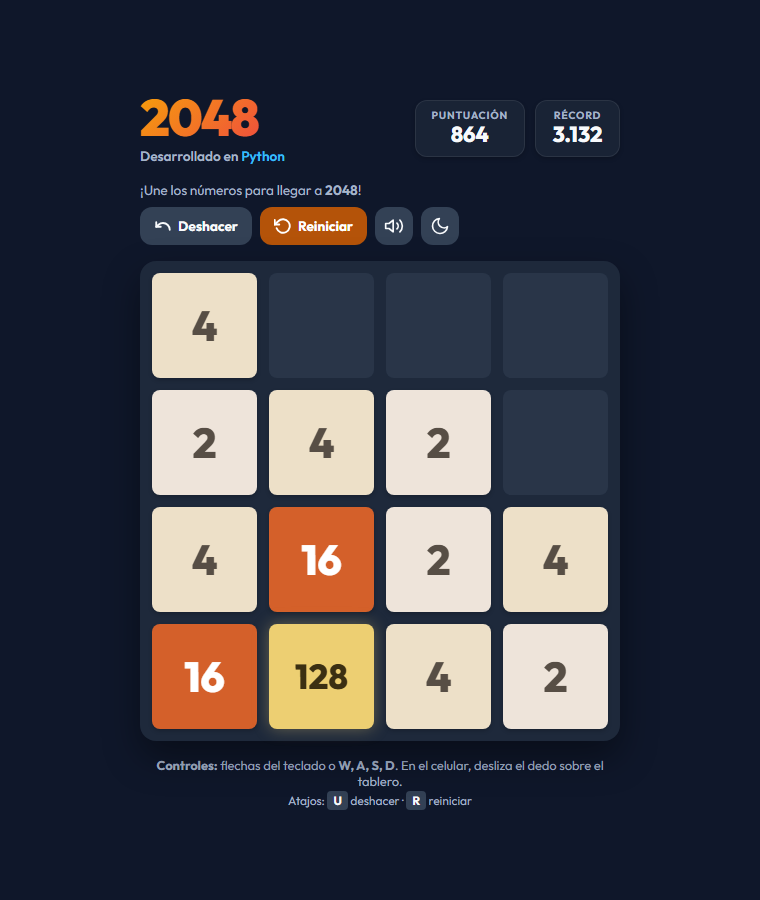

# 2048 en Python

[](https://github.com/DiegoMosqueraC/juego-2048-python/actions/workflows/ci.yml)

Juego basado en **2048** (Cirulli, 2014) escrito en Python con la biblioteca
estándar: no necesita instalar paquetes para jugar. En la interfaz web eliges el
modo con el selector de la parte superior: **Expedición**, una variante tipo
*roguelike* en la que cada partida es distinta, o **Clásico**. Cada modo conserva
su propia partida al cambiar de uno a otro. El **modo terminal** juega el clásico
y funciona en Linux, macOS y Windows.

Este repositorio es también el producto de la asignatura *Codificación y Pruebas
del Software*: contiene la versión base recibida, el registro de fallos, las
correcciones hechas con TDD, la suite de pruebas automatizadas y el pipeline de
integración continua.



---

## Modo expedición

Cada partida es una expedición de 6 pisos con su propia **semilla**. Ninguna se
juega igual: las cartas, las maldiciones y la tienda cambian en cada una.

1. **Pisos.** Cada piso tiene una ficha objetivo: 64, 128, 256, 512, 1024 y, en el
   último, 2048. El tablero se conserva de un piso al siguiente.
2. **Oro.** Al superar un piso, sus puntos se convierten en oro (1 por cada 100,
   mínimo 1). Por eso conviene hacer más puntos: más oro compra más cartas.
3. **Racha.** Cada jugada seguida con fusión suma un 10 % de puntos (hasta ×2);
   una jugada sin fusión o deshacer la reinicia.
4. **Carta gratis y tienda.** Se elige 1 de 3 cartas gratis; las otras dos quedan
   en la tienda, donde se compran con oro o se renueva la oferta (2 de oro).
5. **Pisos guardianes.** Los pisos 3 y 6 traen dos maldiciones a la vez; superar
   el 3 ofrece solo cartas raras o legendarias. Desde el piso 4 ya no sale *Calma*.
6. **La mina se ensancha.** Al llegar al piso de 1024 el tablero pasa a 5×5 y al de
   2048 a 6×6; la carta *Expansión* puede llevarlo hasta 7×7.
7. **Deshacer** gasta usos: empiezas con uno. Si el tablero se bloquea o se acaban
   las jugadas de *Prisa*, la expedición termina.

| Carta | Rareza (precio) | Efecto |
| :--- | :--- | :--- |
| Segunda oportunidad | Común (4) | Suma 2 usos de deshacer. |
| Codicia | Común (4) | Las fusiones dan un 50 % más de puntos (acumulable). |
| Escoba | Común (4) | Elimina todas las fichas de 2. |
| Trébol | Común (4) | Más fichas nuevas de 4 (hasta 50 %). |
| Bolsa de oro | Común (4) | Ganas 5 de oro. |
| Dinamita | Común (4) | Destruye todas las piedras (solo aparece si hay piedras). |
| Escudo | Rara (7) | Anula las maldiciones del próximo piso. |
| Alquimia | Rara (7) | Convierte todas las fichas de 4 en 8. |
| Interés | Rara (7) | Al superar un piso, 1 de oro por cada 5 guardados (máx. 5). |
| Expansión | Legendaria (12) | El tablero crece una fila y una columna (máx. 7×7). |
| Fénix | Legendaria (12) | Si te quedas sin jugadas, borra los 2 y los 4 y sigues (una vez). |

Las comunes salen 6 veces más que las legendarias y las raras 3 veces más.

| Maldición | Efecto |
| :--- | :--- |
| Calma | Ninguno. |
| Piedra | Aparece un bloque que no se mueve ni se fusiona y parte la fila. |
| Derrumbe | Aparecen dos piedras. |
| Prisa | Tienes objetivo ÷ 3 jugadas para llegar a la ficha del piso. |
| Sequía | Las fusiones dan la mitad de puntos. |
| Niebla | Las fichas de 2 y 4 no muestran su número. |
| Terremoto | Cada 8 jugadas el tablero se mueve solo hacia un lado al azar. |

La semilla aparece en pantalla; con `--semilla N` se repite la misma expedición.
Las reglas están en [`roguelike.py`](roguelike.py).

## Requisitos

| Para | Necesitas |
| :--- | :--- |
| Jugar | Python 3.10 o superior y un navegador moderno |
| Vista a color en la terminal de Windows (opcional) | `pip install windows-curses` |
| Ejecutar pruebas y analizadores | `pip install -r requirements-dev.txt` |
| Pruebas de la interfaz web | Node.js 22 o superior |

## Inicio rápido

```bash
python main.py            # menú interactivo
python main.py --web      # interfaz web (abre el navegador)
python main.py --cli      # modo terminal
python main.py --test     # suite de pruebas (requiere pytest)
```

Opciones adicionales:

| Opción | Descripción | Valor por defecto |
| :--- | :--- | :--- |
| `--port N`, `-p N` | Puerto del servidor web (1-65535). Si está ocupado se prueba el siguiente. | 8080 |
| `--size N`, `-s N` | Lado del tablero, de 2 a 8. | 4 |
| `--clasico` | La web abre con el modo Clásico seleccionado (se puede cambiar en la página). | Expedición |
| `--semilla N` | Repite la expedición de esa semilla (entero ≥ 0). | Al azar |
| Variable `JUEGO2048_DATA_DIR` | Carpeta donde se guarda `highscore.json`. | Carpeta del programa |

## Controles

| Acción | Web | Terminal |
| :--- | :--- | :--- |
| Mover | Flechas, `W` `A` `S` `D`, deslizar el dedo o botones táctiles | Flechas o `W` `A` `S` `D` |
| Deshacer | `U` o botón **Deshacer** (en la expedición gasta un uso) | `U` |
| Elegir o comprar carta | `1`, `2`, `3` o clic en la carta | — |
| Reiniciar | `R` o botón **Reiniciar** (pide confirmación si hay puntos) | `R` |
| Seguir tras ganar | Botón **Seguir jugando** | `C` |
| Tema claro/oscuro y sonido | Botones de la barra superior | — |
| Salir | Cerrar la pestaña | `Q` o `Esc` |

## Arquitectura

```
main.py ──► web_ui.py ──► logic.py ──► storage.py
   │            │             │
   └──► terminal_ui.py ───────┘        validation.py y config.py
                │                      (usados por todos los módulos)
static/ (index.html, style.css, app.js, game-utils.js)
```

| Módulo | Responsabilidad |
| :--- | :--- |
| `config.py` | Constantes del juego y del servidor (sin números mágicos). |
| `validation.py` | Validación defensiva de dirección, tamaño, tablero, puntuación y puerto. |
| `storage.py` | Récord en JSON con escritura atómica; interfaz `HighscoreStorage`. |
| `logic.py` | Reglas del juego. Recibe el almacenamiento y el azar por inyección de dependencias. |
| `roguelike.py` | Modo expedición: pisos, maldiciones, bendiciones, usos de deshacer y semilla. |
| `web_ui.py` | Servidor HTTP local, API JSON y cabeceras de seguridad. |
| `terminal_ui.py` | Modo terminal con `curses` o modo de texto básico. |
| `static/` | Cliente web: animaciones, sonido sintetizado, accesibilidad y temas. |
| `tests/` | Pruebas unitarias, de integración, de sistema, de aceptación y de regresión. |

### API JSON

| Método y ruta | Cuerpo | Respuesta |
| :--- | :--- | :--- |
| `GET /api/state` | — | Estado de la partida |
| `POST /api/move` | `{"direction": "left"}` | Estado + `moved`, `points`, `tile_moves`, `merged_cells`, `new_tile` |
| `POST /api/undo` | `{}` | Estado + `undone` |
| `POST /api/reset` | `{}` | Estado de la partida nueva |
| `POST /api/continue` | `{}` | Estado, o `409` si no hay una victoria pendiente |
| `POST /api/mode` | `{"mode": "classic"}` o `{"mode": "expedition"}` | Estado de la partida de ese modo; `400` si el modo no existe |
| `POST /api/choose` | `{"index": 0}` | Toma gratis esa carta y abre la tienda; `400` si el índice no es válido; `409` si no hay elección pendiente |
| `POST /api/shop` | `{"action": "buy", "index": 0}`, `{"action": "reroll"}` o `{"action": "leave"}` | Compra, renueva la oferta o baja al piso siguiente; `400` si la acción no es válida; `409` si falta oro o la tienda está cerrada |

Todo estado incluye `mode` (`"classic"` o `"expedition"`). En la expedición trae además un objeto
`expedition` con el piso, el objetivo, las maldiciones, las jugadas restantes, el
oro, la racha, el mazo, la oferta de cartas, la tienda, el último suceso
(terremoto, fénix o escudo) y la semilla. Las
piedras llegan en `grid` con el valor `-1`.

Los comandos deben enviarse con `Content-Type: application/json`, el cuerpo no
puede superar 1 KB y el servidor solo acepta nombres de host locales.

## Calidad y pruebas

```bash
pip install -r requirements-dev.txt
python ci_local.py                      # todo el pipeline en tu equipo
pytest --cov --cov-report=term-missing  # pruebas en Python con cobertura
node --test "tests/js/*.test.js"        # pruebas de la interfaz web
flake8 .                                # PEP 8 y complejidad ciclomática
bandit -r . -x ./tests,./docs           # análisis de seguridad
```

| Indicador | Versión base | Versión actual |
| :--- | ---: | ---: |
| Advertencias de flake8 | 63 | 0 |
| Hallazgos de bandit | 4 | 0 |
| Complejidad ciclomática de `move()` | 13 | 3 |
| Pruebas automatizadas | 12 | 393 (383 Python + 10 JavaScript) |
| Cobertura de sentencias y ramas | 40 % | 97,6 % |

El flujo [`.github/workflows/ci.yml`](.github/workflows/ci.yml) ejecuta los mismos
pasos en Ubuntu y Windows con Python 3.10 y 3.12 en cada *push* o *pull request*.
Los resultados están en la pestaña
[Actions](https://github.com/DiegoMosqueraC/juego-2048-python/actions) del repositorio.

## Mantenimiento y control de versiones

- Cada cambio se hace en una rama propia (`fix/…`, `refactor/…`, `feat/…`,
  `test/…`, `ci/…`, `docs/…`) y se integra a `main` con un *merge* explícito.
- Los mensajes siguen [Conventional Commits](https://www.conventionalcommits.org/es/v1.0.0/).
- Todo fallo se registra en [docs/REGISTRO_FALLOS.md](docs/REGISTRO_FALLOS.md) con su
  prueba de regresión y el commit que lo corrige.
- El [informe técnico](docs/INFORME_TECNICO.md) resume las decisiones de
  codificación y las evidencias en [docs/evidencias/](docs/evidencias/).
- Los cambios por versión están en [CHANGELOG.md](CHANGELOG.md).

## Reglas del juego

1. Desliza las fichas en una de las cuatro direcciones.
2. Dos fichas iguales que chocan se fusionan en una con el doble de valor; una
   ficha solo se fusiona una vez por jugada.
3. Tras cada jugada válida aparece una ficha nueva: 2 (90 %) o 4 (10 %).
4. Llegar a **2048** es la victoria; después puedes seguir jugando.
5. La partida termina cuando el tablero está lleno y no hay fusiones posibles.

## Créditos

- Juego original: Gabriele Cirulli (2014), <https://github.com/gabrielecirulli/2048>.
- Mantenimiento, pruebas y documentación: Diego Mosquera.
