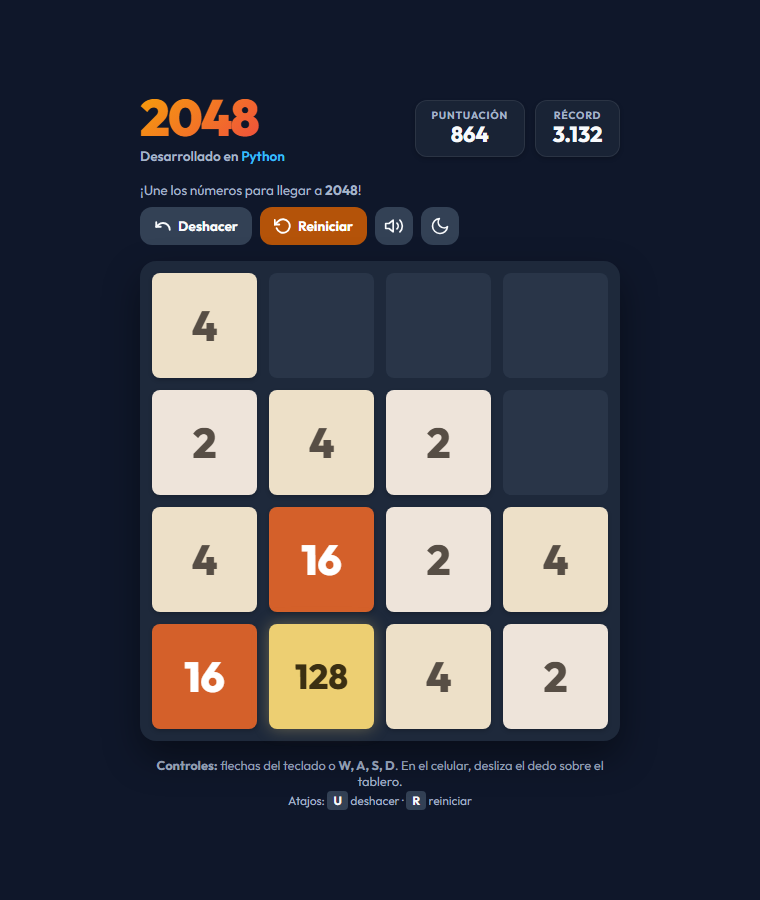

# 2048 en Python

[](https://github.com/DiegoMosqueraC/juego-2048-python/actions/workflows/ci.yml)

Recreación del juego **2048** (Cirulli, 2014) escrita en Python con la biblioteca
estándar: no necesita instalar paquetes para jugar. Ofrece una **interfaz web**
con animaciones, sonido y accesibilidad, y un **modo terminal** que funciona en
Linux, macOS y Windows.

Este repositorio es también el producto de la asignatura *Codificación y Pruebas
del Software*: contiene la versión base recibida, el registro de fallos, las
correcciones hechas con TDD, la suite de pruebas automatizadas y el pipeline de
integración continua.



---

## Requisitos

| Para | Necesitas |
| :--- | :--- |
| Jugar | Python 3.10 o superior y un navegador moderno |
| Vista a color en la terminal de Windows (opcional) | `pip install windows-curses` |
| Ejecutar pruebas y analizadores | `pip install -r requirements-dev.txt` |
| Pruebas de la interfaz web | Node.js 22 o superior |

## Inicio rápido

```bash
python main.py            # menú interactivo
python main.py --web      # interfaz web (abre el navegador)
python main.py --cli      # modo terminal
python main.py --test     # suite de pruebas (requiere pytest)
```

Opciones adicionales:

| Opción | Descripción | Valor por defecto |
| :--- | :--- | :--- |
| `--port N`, `-p N` | Puerto del servidor web (1-65535). Si está ocupado se prueba el siguiente. | 8080 |
| `--size N`, `-s N` | Lado del tablero, de 2 a 8. | 4 |
| Variable `JUEGO2048_DATA_DIR` | Carpeta donde se guarda `highscore.json`. | Carpeta del programa |

## Controles

| Acción | Web | Terminal |
| :--- | :--- | :--- |
| Mover | Flechas, `W` `A` `S` `D`, deslizar el dedo o botones táctiles | Flechas o `W` `A` `S` `D` |
| Deshacer | `U` o botón **Deshacer** | `U` |
| Reiniciar | `R` o botón **Reiniciar** (pide confirmación si hay puntos) | `R` |
| Seguir tras ganar | Botón **Seguir jugando** | `C` |
| Tema claro/oscuro y sonido | Botones de la barra superior | — |
| Salir | Cerrar la pestaña | `Q` o `Esc` |

## Arquitectura

```
main.py ──► web_ui.py ──► logic.py ──► storage.py
   │            │             │
   └──► terminal_ui.py ───────┘        validation.py y config.py
                │                      (usados por todos los módulos)
static/ (index.html, style.css, app.js, game-utils.js)
```

| Módulo | Responsabilidad |
| :--- | :--- |
| `config.py` | Constantes del juego y del servidor (sin números mágicos). |
| `validation.py` | Validación defensiva de dirección, tamaño, tablero, puntuación y puerto. |
| `storage.py` | Récord en JSON con escritura atómica; interfaz `HighscoreStorage`. |
| `logic.py` | Reglas del juego. Recibe el almacenamiento y el azar por inyección de dependencias. |
| `web_ui.py` | Servidor HTTP local, API JSON y cabeceras de seguridad. |
| `terminal_ui.py` | Modo terminal con `curses` o modo de texto básico. |
| `static/` | Cliente web: animaciones, sonido sintetizado, accesibilidad y temas. |
| `tests/` | Pruebas unitarias, de integración, de sistema, de aceptación y de regresión. |

### API JSON

| Método y ruta | Cuerpo | Respuesta |
| :--- | :--- | :--- |
| `GET /api/state` | — | Estado de la partida |
| `POST /api/move` | `{"direction": "left"}` | Estado + `moved`, `points`, `tile_moves`, `merged_cells`, `new_tile` |
| `POST /api/undo` | `{}` | Estado + `undone` |
| `POST /api/reset` | `{}` | Estado de la partida nueva |
| `POST /api/continue` | `{}` | Estado, o `409` si no hay una victoria pendiente |

Los comandos deben enviarse con `Content-Type: application/json`, el cuerpo no
puede superar 1 KB y el servidor solo acepta nombres de host locales.

## Calidad y pruebas

```bash
pip install -r requirements-dev.txt
python ci_local.py                      # todo el pipeline en tu equipo
pytest --cov --cov-report=term-missing  # pruebas en Python con cobertura
node --test "tests/js/*.test.js"        # pruebas de la interfaz web
flake8 .                                # PEP 8 y complejidad ciclomática
bandit -r . -x ./tests,./docs           # análisis de seguridad
```

| Indicador | Versión base | Versión actual |
| :--- | ---: | ---: |
| Advertencias de flake8 | 63 | 0 |
| Hallazgos de bandit | 4 | 0 |
| Complejidad ciclomática de `move()` | 13 | 3 |
| Pruebas automatizadas | 12 | 283 (273 Python + 10 JavaScript) |
| Cobertura de sentencias y ramas | 40 % | 96,6 % |

El flujo [`.github/workflows/ci.yml`](.github/workflows/ci.yml) ejecuta los mismos
pasos en Ubuntu y Windows con Python 3.10 y 3.12 en cada *push* o *pull request*.
Los resultados están en la pestaña
[Actions](https://github.com/DiegoMosqueraC/juego-2048-python/actions) del repositorio.

## Mantenimiento y control de versiones

- Cada cambio se hace en una rama propia (`fix/…`, `refactor/…`, `feat/…`,
  `test/…`, `ci/…`, `docs/…`) y se integra a `main` con un *merge* explícito.
- Los mensajes siguen [Conventional Commits](https://www.conventionalcommits.org/es/v1.0.0/).
- Todo fallo se registra en [docs/REGISTRO_FALLOS.md](docs/REGISTRO_FALLOS.md) con su
  prueba de regresión y el commit que lo corrige.
- El [informe técnico](docs/INFORME_TECNICO.md) resume las decisiones de
  codificación y las evidencias en [docs/evidencias/](docs/evidencias/).
- Los cambios por versión están en [CHANGELOG.md](CHANGELOG.md).

## Reglas del juego

1. Desliza las fichas en una de las cuatro direcciones.
2. Dos fichas iguales que chocan se fusionan en una con el doble de valor; una
   ficha solo se fusiona una vez por jugada.
3. Tras cada jugada válida aparece una ficha nueva: 2 (90 %) o 4 (10 %).
4. Llegar a **2048** es la victoria; después puedes seguir jugando.
5. La partida termina cuando el tablero está lleno y no hay fusiones posibles.

## Créditos

- Juego original: Gabriele Cirulli (2014), <https://github.com/gabrielecirulli/2048>.
- Mantenimiento, pruebas y documentación: Diego Mosquera.
