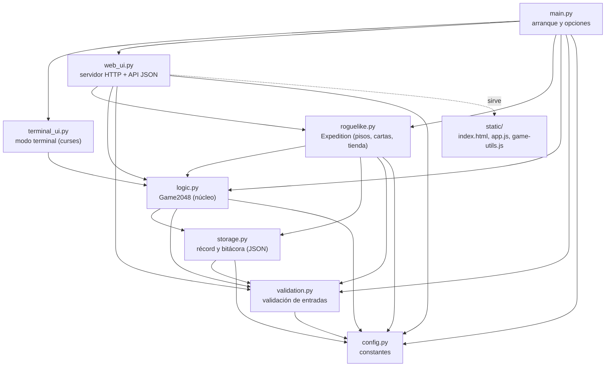
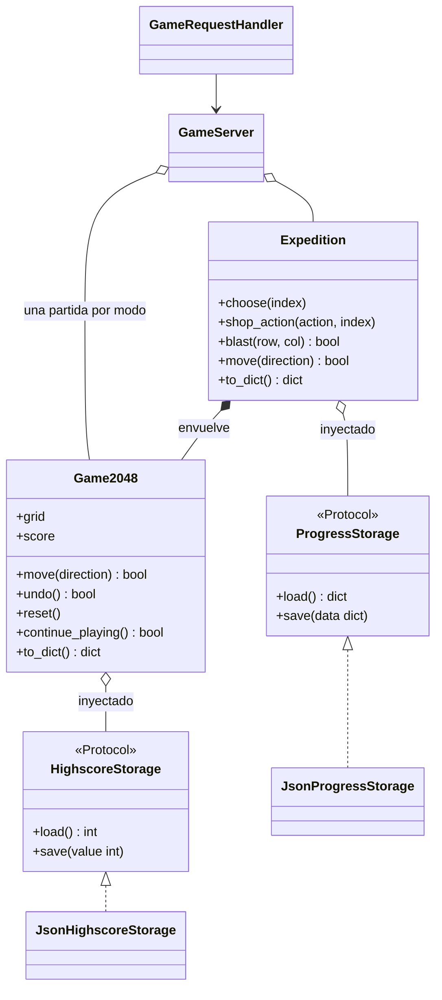

# Arquitectura del juego 2048 «La Mina»

Evidencia de los ítems **B3** (modularidad y SOLID) y del diagrama de componentes
y de clases que pide el examen final.

## 1. Diagrama de componentes

Las flechas van del módulo que importa al que es importado. No hay ciclos: la
dependencia siempre apunta hacia `config`.



Las dependencias salen de las importaciones reales de cada archivo.

## 2. Diagrama de clases



`Expedition` expone la misma interfaz que `Game2048` (`move`, `undo`, `reset`,
`continue_playing`, `to_dict`), así que la capa web trata a ambos igual.

## 3. Bajo acoplamiento y alta cohesión

| Módulo | Única responsabilidad | Depende de |
| --- | --- | --- |
| `config.py` | Constantes del juego | nada |
| `validation.py` | Verificar entradas externas (funciones puras) | `config` |
| `storage.py` | Guardar y leer el récord y la bitácora | `config`, `validation` |
| `logic.py` | Reglas del 2048 | `config`, `storage`, `validation` |
| `roguelike.py` | Reglas de la expedición | `logic`, `storage`, ... |
| `terminal_ui.py` | Dibujar y leer teclas en la terminal | `logic` |
| `web_ui.py` | Exponer el juego como API HTTP | `logic`, `roguelike`, ... |

La interfaz web y la de terminal no se conocen entre sí, y ninguna regla del juego
importa una interfaz.

## 4. Principios SOLID con evidencia

### S: responsabilidad única

`validation.py` solo valida; `storage.py` solo persiste; `logic.py` no toca el
disco ni el HTTP. Por ejemplo, `normalize_direction` solo convierte y verifica
una dirección (código resumido):

```python
def normalize_direction(value: object) -> str:
    if not isinstance(value, str):
        raise ValueError(f"La dirección debe ser texto, se recibió {type(value).__name__}")
    direction = DIRECTION_ALIASES.get(value.strip().lower(), value.strip().lower())
    if direction not in DIRECTIONS:
        raise ValueError(f"Dirección inválida: {value!r}")
    return direction
```

### O: abierto a extensión, cerrado a modificación

El modo expedición se agregó **sin modificar** el algoritmo de `Game2048`:
`Expedition` lo envuelve y cambia el comportamiento mediante atributos
(`points_multiplier`, `probability_of_four`). Las piedras entraron como un caso
nuevo de `slide_line`, que reutiliza `slide_and_merge_line` sin cambiarla
(commit `664749f`).

### D: inversión de dependencias

`Game2048` no depende de un archivo concreto sino del contrato `HighscoreStorage`
(`storage.py`). La implementación se inyecta en el constructor:

```python
class HighscoreStorage(Protocol):
    def load(self) -> int: ...
    def save(self, value: int) -> None: ...

class Game2048:
    def __init__(self, size=DEFAULT_BOARD_SIZE,
                 storage: Optional[HighscoreStorage] = None,
                 rng: Optional[random.Random] = None): ...
```

Gracias a eso, las pruebas sustituyen el disco y el azar por dobles
(`FakeHighscoreStorage`, `StubRandom` en `tests/doubles.py`).

### L: sustitución de Liskov

Tanto `JsonHighscoreStorage` como `FakeHighscoreStorage` cumplen el contrato
`HighscoreStorage`, y `Expedition` es intercambiable con `Game2048` en `web_ui.py`.
La API trata a ambos igual porque solo usa los métodos comunes.

Se cumplen cuatro de los cinco principios (S, O, L, D). El principio I
(segregación de interfaces) se aplica solo en parte: los contratos `Protocol`
tienen dos métodos cada uno.
