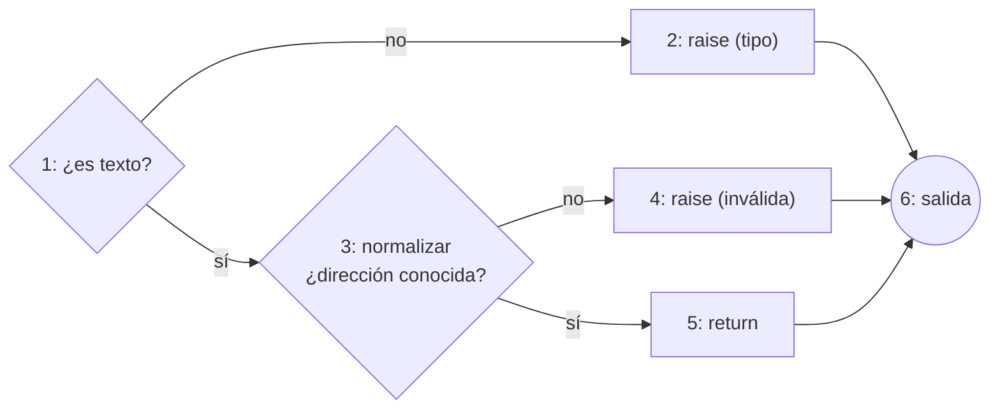
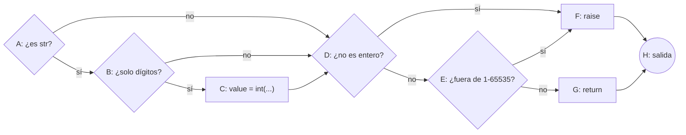

# Evidencias del examen final

Detalle técnico de los ítems de la lista de chequeo que necesitan más que un
enlace. Los comandos se ejecutaron sobre el commit `057bbf1` más los cambios de
esta rama; los resultados están en [evidencias/05_examen_final](evidencias/05_examen_final/).

## B2. Complejidad ciclomática

Reporte: [radon_complejidad.txt](evidencias/05_examen_final/radon_complejidad.txt)
(`python -m radon cc -s -a . -e "tests/*"`).

- **Resultado:** 151 bloques de código de producción, complejidad media **A (3,2)**.
  Ninguna función supera 10.
- **Función que superaba el umbral:** `validate_grid` en `validation.py` marcaba
  **C (11)** con radon, que cuenta cada `and`/`or` y cada condición de una
  comprensión. flake8 (mccabe) la daba por válida con 10.
- **Qué se hizo:** se extrajo `_is_valid_cell` y la función bajó a B. Es un
  cambio preventivo sin efecto visible; las 431 pruebas siguen pasando.
- Las funciones más complejas hoy son `slide_and_merge_line` (B, 7) y
  `validate_port` (A, 5).

## B4. Entradas validadas

Todas las entradas externas pasan por `validation.py` (funciones puras que
lanzan `ValueError`). La API responde con el error HTTP indicado.

| Entrada | Regla | Respuesta ante error |
| --- | --- | --- |
| Dirección del movimiento | Texto; alias en español; solo `left/right/up/down` | `ValueError` → API 400 |
| Tamaño del tablero | Entero estricto (no `bool`) entre 2 y 8 | `ValueError` → API 400 |
| Tablero (`from_grid`) | Lista cuadrada de fichas 0, piedra o potencia de 2 | `ValueError` |
| Puntuación y récord | Entero no negativo; el archivo se valida al leerlo | Se registra el aviso (`logger.warning`) y se parte de 0 |
| Semilla | Entero no negativo | `ValueError` → API 400 |
| Puerto | Entero 1-65535 (acepta texto con dígitos) | `ValueError` y salida de la CLI |
| Cuerpo JSON de la API | Objeto JSON, `Content-Length` numérico y con tope de tamaño | 400 o 413 |
| Encabezado `Host` y `Content-Type` | Host local permitido y JSON en los POST | 403 o 415 |
| Casilla de la dinamita | Fila y columna enteras dentro del tablero y con una piedra | `ValueError` → API 400 |
| `reset` con `daily` | Booleano; solo en modo expedición | 400 (no booleano) o 409 (clásico) |

**Escaneo de secretos:** el código no contiene credenciales.
- `bandit -r . -x ./tests,./docs` no reporta hallazgos de contraseñas ni claves
  fijas ([bandit_secretos.txt](evidencias/05_examen_final/bandit_secretos.txt)).
- Una búsqueda con expresión regular de `password|secret|api_key|token` asignados a
  una cadena en todo el historial (`git log -p --all -G`) no devolvió ninguna
  coincidencia. No se usó una herramienta dedicada como gitleaks.

## B7. Cambio evolutivo y trazabilidad

Fallos: 23 en [REGISTRO_FALLOS.md](REGISTRO_FALLOS.md), con su tipo (14
correctivos, 4 preventivos, 3 perfectivos, 2 adaptativos) y su commit.

**Cambio evolutivo EV-01: modo expedición («La Mina»).** Convierte el 2048 en un
juego de rondas con cartas, maldiciones, tienda y pisos que crecen.

| Paso | Commit | Prueba que lo protege |
| --- | --- | --- |
| Piedras y multiplicador en el núcleo | `664749f` | `tests/test_piedras.py` |
| `Expedition`, pisos, cartas, maldiciones | `912314d` | `tests/test_expedicion.py` |
| API y selector de modo | `53b7b6c`, `d644057`, `c6abd35` | `tests/test_web_api.py` |
| Oro, tienda, rarezas, guardianes | `fdae940` | `tests/test_expedicion.py` |
| Rediseño visual | `fd1767b` | revisión manual en el navegador |
| Mina que crece, reto del día, dinamita, modo infinito | `ecb9abc`, `f3fb576`, `86e8ceb` | `tests/test_expedicion.py`, `tests/test_storage.py` |

Versiones: 2.1.0 a 2.4.0 en [CHANGELOG.md](../CHANGELOG.md).

## C1. Estructura Arrange-Act-Assert

Las pruebas de `tests/` siguen el orden preparar (Arrange), actuar (Act) y verificar
(Assert). Ejemplo real de `tests/test_expedicion.py`:

```python
def test_blast_removes_a_stone_and_spends_a_cartridge(expedition):
    expedition.game.grid = [[S, 2, 0, 0], EMPTY_ROW, EMPTY_ROW, EMPTY_ROW]   # Arrange
    assert expedition.blast(0, 0) is True                                     # Act + Assert
    assert expedition.game.grid[0][0] == 0
    assert expedition.dynamite == STARTING_DYNAMITE - 1
```

Los nombres expresan el comportamiento (`test_no_tile_is_added_when_the_board_is_full`,
`test_losing_in_endless_mode_does_not_count_twice`). Cada prueba crea su propio
juego con `make_game` y dobles; no comparten estado ni dependen del orden.
La ejecución completa está en [pytest_cobertura.txt](evidencias/05_examen_final/pytest_cobertura.txt):
431 pruebas, cobertura del 97,7 %.

## C3. Caja blanca: grafo de flujo y V(G)

Fórmula: **V(G) = aristas − nodos + 2** (un único nodo de salida). Los valores
coinciden con radon.

### `normalize_direction` (`validation.py`)



Nodos = 6, aristas = 7 → **V(G) = 7 − 6 + 2 = 3**.

| Camino | Recorrido | Prueba |
| --- | --- | --- |
| 1 | 1-2-6 | `test_normalize_direction_invalid_partitions` con `None`, `1`, `b"left"` |
| 2 | 1-3-4-6 | la misma prueba con `""`, `"norte"`, `"upp"` |
| 3 | 1-3-5-6 | `test_normalize_direction_valid_partitions` |

### `validate_port` (`validation.py`)



Nodos = 8, aristas = 11 → **V(G) = 11 − 8 + 2 = 5**.

| Camino | Recorrido | Entrada | Prueba |
| --- | --- | --- | --- |
| 1 | A-B-C-D-E-G-H | `"8080"` | `test_port_valid_limits` |
| 2 | A-D-E-G-H | `1` o `65535` (entero) | `test_port_valid_limits` |
| 3 | A-B-D-F-H | `"abc"` | `test_port_invalid` |
| 4 | A-D-F-H | `None`, `8080.0` | `test_port_invalid` |
| 5 | A-D-E-F-H | `0`, `65536`, `-80` | `test_port_invalid` |

**Cobertura de sentencias y ramas:** 97,7 % con `branch = True`
([pytest_cobertura.txt](evidencias/05_examen_final/pytest_cobertura.txt)); `validation.py`
está al 100 %. Además, `slide_and_merge_line` (V(G) = 5 según el taller de proceso de prueba)
tiene su camino base en `tests/test_slide_merge.py`.

## C4. Estrategia de integración

**Bottom-up (de abajo hacia arriba).** Se eligió porque los módulos de las capas
bajas (`validation`, `storage`, `logic`) no dependen de nada visible al usuario y
se pueden probar solos con dobles; luego se suben las capas que los usan.

| Nivel | Qué se integra | Pruebas |
| --- | --- | --- |
| 1 | `validation` + `config` | `tests/test_validation.py` |
| 2 | `storage` con un archivo real en una carpeta temporal | `tests/test_storage.py` |
| 3 | `logic` + `storage` + `validation` | `tests/test_game.py`, `tests/test_regresion.py` |
| 4 | `roguelike` sobre `logic` y la bitácora | `tests/test_expedicion.py`, `tests/test_piedras.py` |
| 5 | `web_ui` completo con un servidor HTTP real | `tests/test_web_api.py` (más de 3 pruebas entre módulos) |

Cada nivel se prueba con las capas inferiores reales, y solo se sustituye el
azar y el disco cuando hace falta aislar.

## C4. Dobles de prueba y su justificación

Código en [tests/doubles.py](../tests/doubles.py).

| Doble | Tipo | Qué aísla | Por qué se eligió |
| --- | --- | --- | --- |
| `FakeHighscoreStorage` | fake + spy | El archivo `highscore.json` | Funciona como un almacén real pero en memoria; el spy cuenta los `save` para verificar que el récord solo se guarda al mejorar |
| `FakeProgressStorage` | fake + spy | `progress.json` | Igual, para la bitácora; evita ensuciar el récord del jugador |
| `StubRandom` | stub | El generador aleatorio | Decide dónde y con qué valor sale cada ficha, de modo que el resultado es exacto y repetible |
| Módulo `curses` falso (`tests/test_terminal_ui.py`) | fake | El módulo `curses`, que no existe en Windows | Una pantalla en memoria que falla al escribir fuera de la ventana, como curses real; permite probar el modo terminal en cualquier sistema |

## D1. Plan de pruebas: sección de recursos

Complementa el plan PP-2048-v1.0 del taller de proceso de prueba, que no traía
una sección de recursos:

- **Humanos:** tres integrantes con 4 horas semanales cada uno (12 h/semana).
- **Hardware y sistemas:** equipos con Windows 11 y Ubuntu (GitHub Actions).
- **Software:** Python 3.10 y 3.12, Node.js 22, pytest, pytest-cov, flake8, bandit,
  radon y un navegador moderno.
- **Servicios:** GitHub (repositorio y GitHub Actions) sin costo.
- **Datos:** tableros fijos con `from_grid` y semillas fijas; ningún dato real.

## D2. Esfuerzo estimado y medido

La estimación (56,2 h en 5 semanas, con prioridad por exposición al riesgo P × I)
está en el taller de proceso de prueba. Lo que se pudo medir:

| Concepto | Estimado | Medido |
| --- | --- | --- |
| Ejecución de la suite de Python (431 pruebas) | 0,5 min por caso | 13 s en total |
| Ejecución en el pipeline (4 combinaciones) | n/a | unos 87 s de media por ejecución (taller de CI) |
| Horas de diseño y reporte | 56,2 h | **sin registro**: el equipo no anotó las horas reales |

Este es el único punto que no se puede cerrar con el repositorio: el equipo debe
anotar las horas reales de cada integrante para completar la comparación.
