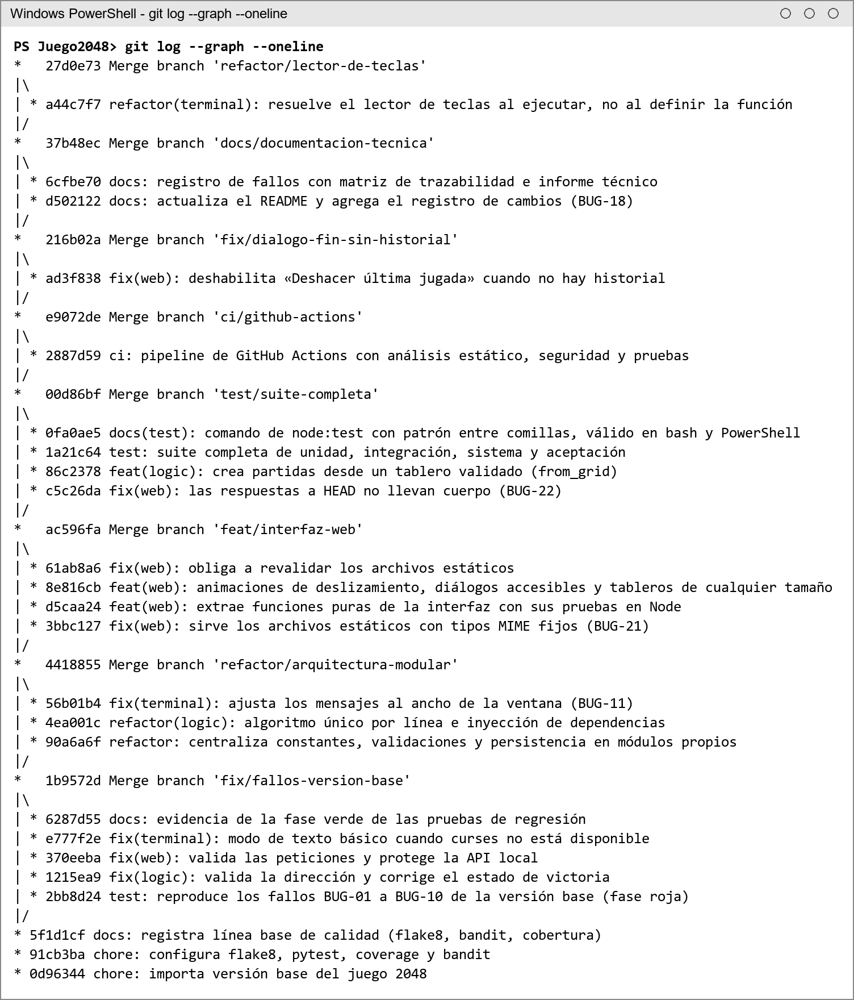
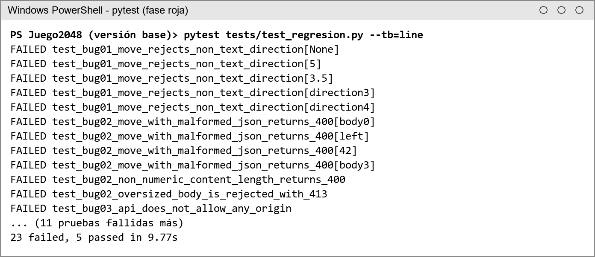
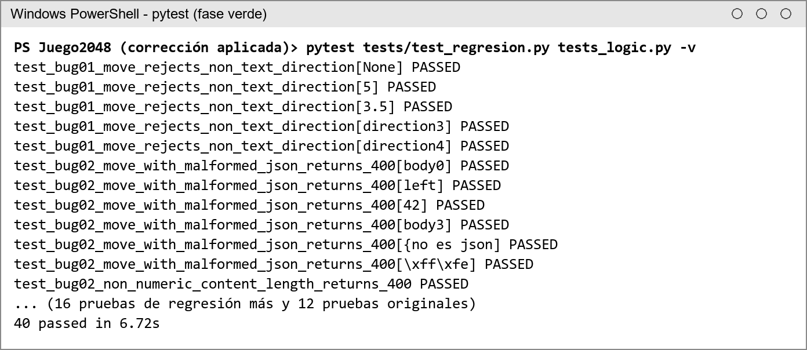
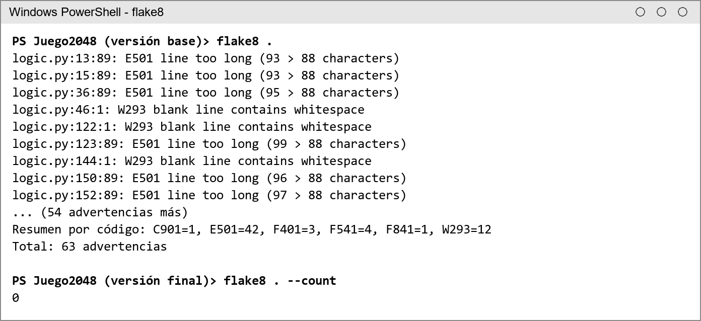
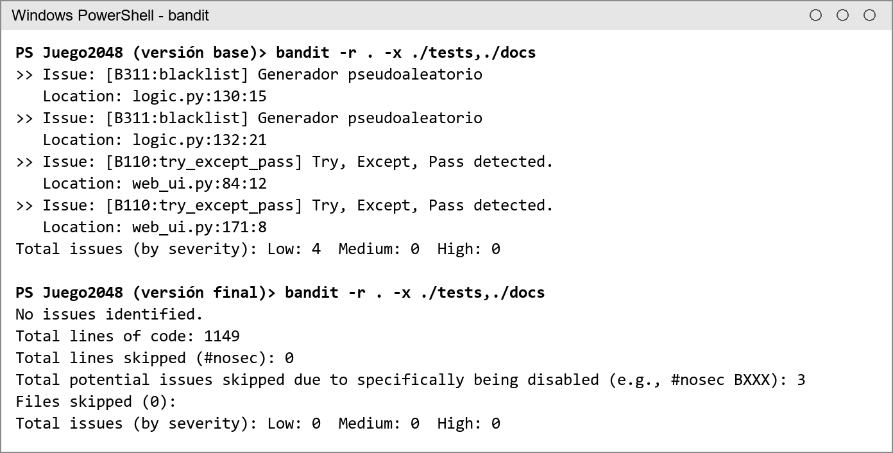
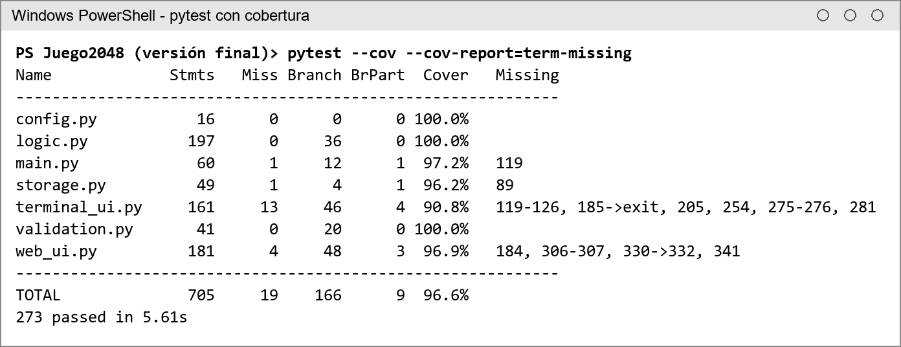
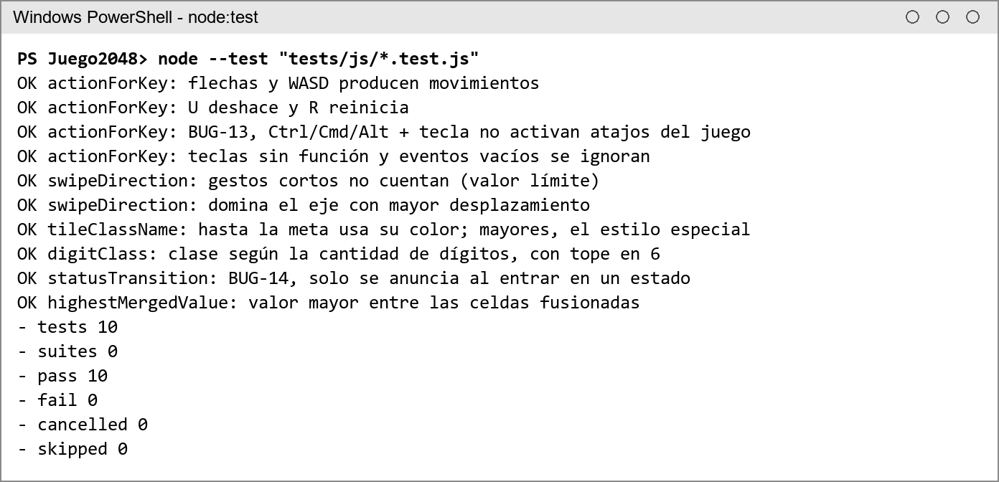
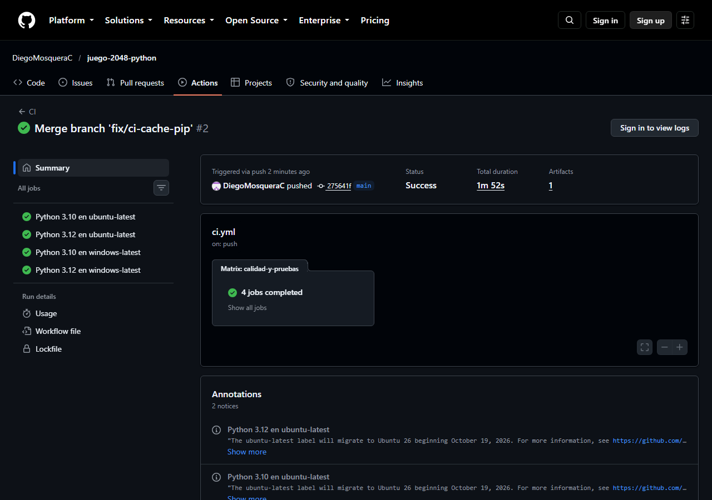

# Informe técnico: mantenimiento y pruebas del juego 2048

Asignatura: Codificación y Pruebas del Software (FESC). Este informe acompaña al
documento en formato APA y resume, con evidencias del repositorio, las
decisiones de codificación, los fallos encontrados, las pruebas y el pipeline de
integración continua.

## 1. Resultado en cifras

| Indicador | Versión base | Versión final |
| --- | --- | --- |
| Advertencias de flake8 | 63 | 0 |
| Hallazgos de bandit (severidad baja) | 4 | 0 (3 supresiones justificadas) |
| Complejidad ciclomática de move() | 13 | 3 |
| Funciones con complejidad mayor o igual que 10 | 5 | 0 |
| Pruebas automatizadas | 12 | 283 (273 Python + 10 JavaScript) |
| Cobertura de sentencias y ramas | 40 % | 96,6 % |
| Cobertura de web_ui.py y terminal_ui.py | 0 % y 0 % | 96,9 % y 90,8 % |
| Fichas con contraste menor que 3:1 | 9 de 11 | 0 de 11 |
| Fallos registrados y corregidos | — | 23 de 23 |
| Ejecución del flujo de CI en GitHub Actions | No existía | 4 de 4 combinaciones aprobadas |

## 2. Proceso de trabajo

1. Se versionó la entrega original sin cambios (`0d96344`) y se midió su línea
   base con flake8, bandit y pytest (`docs/evidencias/01_linea_base`).
2. Cada fallo se reprodujo primero con una prueba de regresión que fallaba
   (fase roja), luego se corrigió con el cambio mínimo (fase verde) y después se
   refactorizó con las pruebas como red de seguridad.
3. Cada tipo de trabajo se hizo en una rama propia (`fix/`, `refactor/`,
   `feat/`, `test/`, `ci/`, `docs/`) con mensajes Conventional Commits y se
   integró a `main` con *merge* explícito.

## 3. Registro de fallos

Se registraron 23 fallos; la tabla completa y la matriz de trazabilidad
fallo → prueba → commit están en [REGISTRO_FALLOS.md](REGISTRO_FALLOS.md).

## 4. Desarrollo guiado por pruebas (TDD)

**Fase roja.** Las 28 verificaciones de regresión escritas antes de corregir se
ejecutaron contra la versión base: 23 fallaron, lo que confirmó los defectos.

**Fase verde.** Con las correcciones mínimas pasaron las 28 verificaciones y las
12 pruebas originales.

**Refactorización.** Se separaron `config.py`, `validation.py` y `storage.py`, y
`move()` pasó de cuatro ramas duplicadas a un algoritmo por línea. Las mismas
pruebas siguieron en verde.

## 5. Análisis estático y de seguridad

Las tres supresiones de bandit están justificadas en el código: el generador
aleatorio del juego no protege secretos (B311) y `ci_local.py` solo ejecuta
comandos fijos sin intérprete de órdenes (B404, B603).

## 6. Estrategia de pruebas

| Archivo | Nivel y técnica | Casos |
| --- | --- | --- |
| test_logic.py | Unidad (originales migradas) | 12 |
| test_slide_merge.py | Unidad, caja blanca | 14 |
| test_game.py | Unidad, caja negra | 60 |
| test_validation.py | Unidad, caja negra | 57 |
| test_storage.py | Integración con disco | 13 |
| test_web_api.py | Integración HTTP, caja gris | 30 |
| test_terminal_ui.py | Unidad con dobles (fake, stub, spy) | 22 |
| test_main.py | Unidad con mocks | 23 |
| test_sistema.py | Sistema y aceptación | 7 |
| test_regresion.py | Regresión (BUG-01 a BUG-22) | 35 |
| tests/js/game-utils.test.js | Unidad JavaScript (node:test) | 10 |

Dobles de prueba usados: *fake* (récord en memoria, módulo curses falso), *stub*
(azar y teclas preparados), *spy* (registro de guardados y de la salida) y
*mock* (servidor, navegador y pytest con `unittest.mock`).

### Casos de prueba representativos

| ID | Nivel | Técnica | Entrada | Resultado esperado |
| --- | --- | --- | --- | --- |
| CP-01 | Unidad | Caja blanca (decisión: bucle sin iteraciones) | slide_and_merge_line([0, 0, 0, 0]) | (0, 0, 0, 0) y 0 puntos |
| CP-02 | Unidad | Caja blanca (última ficha sin vecina) | [0, 0, 0, 8] | (8, 0, 0, 0) |
| CP-03 | Unidad | Caja blanca (no hay doble fusión) | [4, 2, 2, 0] | (4, 4, 0, 0) y 4 puntos |
| CP-04 | Unidad | Caja blanca (dos fusiones) | [8, 8, 16, 16] | (16, 32, 0, 0) y 48 puntos |
| CP-05 | Unidad | Valores límite | Tamaño de tablero 1, 2, 8 y 9 | 2 y 8 válidos; 1 y 9 producen ValueError |
| CP-06 | Unidad | Partición de equivalencia (válidas) | Dirección «left», «  LEFT  », «izquierda» | La jugada se realiza |
| CP-07 | Unidad | Partición de equivalencia (inválidas) | Dirección None, 5, «norte», «» | ValueError |
| CP-08 | Unidad (stub) | Valores límite | Valor aleatorio 0.0999 y 0.1 | Ficha 4 y ficha 2 |
| CP-09 | Unidad | Valores límite | 25 jugadas válidas y deshacer todo | Se deshacen exactamente 20 |
| CP-10 | Unidad | Valores límite | Puerto 0, 1, 65535 y 65536 | 1 y 65535 válidos; 0 y 65536 rechazados |
| CP-11 | Unidad (spy) | Caja negra | Fusionar [2, 2, 4, 4] con récord 0 | Puntuación 12 y un solo guardado con valor 12 |
| CP-12 | Integración | Caja gris | POST /api/move con [2, 2, 0, 0] | 200, moved=true, merged_cells=[[0, 0]] |
| CP-13 | Integración | Seguridad | POST /api/reset con text/plain | 415 |
| CP-14 | Integración | Seguridad | Host: atacante.example | 403 |
| CP-15 | Integración | Valores límite | Content-Length de 10 MB | 413 sin leer el cuerpo |
| CP-16 | Integración | Robustez | Cuerpos [1, 2], «left» y 42 | 400 y el servidor sigue respondiendo |
| CP-17 | Integración | Disco temporal | Archivo de récord dañado | Récord 0 y advertencia en el registro |
| CP-18 | Unidad (fake) | Caja negra | Ventana de 37 columnas con partida terminada | Ningún texto fuera de la ventana; aviso visible |
| CP-19 | Unidad (mock) | Interacción | main --web --port 9000 --size 5 | run_server llamado una vez con puerto 9000 y tablero 5×5 |
| CP-20 | Unidad (JS) | Partición de equivalencia | Ctrl+R, Cmd+R y Alt+← | Ninguna acción del juego |
| CP-21 | Sistema | Caja negra | Partida completa por HTTP hasta el final | Puntuación = suma de puntos; fichas potencias de 2; termina sin movimientos |
| CP-22 | Aceptación | Dado/Cuando/Entonces | HU-03: récord entre sesiones | La nueva sesión muestra el récord 218 |

Todos los casos se ejecutaron y aprobaron en la versión final.

### Pruebas de sistema manuales en el navegador y la consola

| ID | Acción | Resultado esperado | Resultado |
| --- | --- | --- | --- |
| ST-01 | Cargar http://127.0.0.1:8091 en el navegador | Tablero 4×4 con dos fichas y sin errores en la consola | Falló (BUG-21); aprobada tras la corrección |
| ST-02 | Mover con las flechas | Las fichas se deslizan, solo la nueva aparece animada y se actualizan puntuación y anuncio | Aprobada |
| ST-03 | Pulsar R con puntos; luego Tab y Escape | Aparece la confirmación, el foco no sale del diálogo y Escape cancela sin perder la partida | Aprobada |
| ST-04 | Unir 1024 + 1024 | Diálogo de victoria con foco en «Seguir jugando»; las flechas no mueven | Aprobada |
| ST-05 | Pulsar «Seguir jugando» y mover | Se cierra el diálogo y la partida continúa | Aprobada |
| ST-06 | Hacer la última jugada posible | Diálogo de fin con la puntuación final | Aprobada |
| ST-07 | Pulsar «Deshacer última jugada» | La partida se reabre | Aprobada |
| ST-08 | Detener el servidor y mover | Aviso «Sin conexión con el servidor» | Aprobada (aparece a los 2 s en Windows) |
| ST-09 | Vista móvil de 375 px | Sin desplazamiento horizontal y con botones táctiles funcionales | Aprobada |
| ST-10 | Cambiar al tema claro | Colores claros y aria-pressed actualizado | Aprobada |
| ST-11 | Tablero 5×5 (--size 5) y mover | 25 celdas y fusiones correctas | Aprobada |
| ST-12 | Recargar con la partida terminada | Diálogo de fin con «Deshacer» deshabilitado | Falló (BUG-23); aprobada tras la corrección |
| ST-13 | python main.py --cli en Windows PowerShell | Modo de texto básico con el tablero y la ayuda | Aprobada |

## 7. Integración continua

`.github/workflows/ci.yml` ejecuta flake8, bandit, pytest con cobertura mínima
del 90 % y node:test en Ubuntu y Windows con Python 3.10 y 3.12. El mismo
proceso se ejecuta localmente con `python ci_local.py`
(`docs/evidencias/04_resultado_final/ci_local.txt`).

La primera ejecución en GitHub falló en los cuatro trabajos al instalar Python:
`cache: pip` busca `requirements.txt` por defecto y el proyecto usa
`requirements-dev.txt`. Además, GitHub advirtió que las acciones usadas dependían
de Node.js 20, ya obsoleto. La rama `fix/ci-cache-pip` agregó
`cache-dependency-path` y actualizó las acciones a la versión 7; la segunda
ejecución aprobó las cuatro combinaciones en 1 min 52 s
([ejecución 39628865728](https://github.com/DiegoMosqueraC/juego-2048-python/actions/runs/39628865728)).

## 8. Plan de mantenimiento

| Tipo | Acción prevista | Disparador |
| --- | --- | --- |
| Correctivo | Todo reporte nuevo se registra como BUG-xx y se corrige con una prueba de regresión primero. | Reporte de un usuario o fallo del pipeline |
| Adaptativo | Probar cada versión nueva de Python y de los navegadores en la matriz de CI. | Publicación de Python 3.14+, cambios del navegador o del entorno de CI (GitHub anunció que ubuntu-latest pasará a Ubuntu 26) |
| Perfectivo | Guardar la partida en curso y tabla de mejores puntuaciones. | Solicitud de los usuarios |
| Preventivo | Mantener la complejidad por función en 10 o menos y la cobertura sobre 90 %. | Cada *pull request* |

## 9. Evidencias

- `docs/evidencias/01_linea_base`: flake8, bandit y cobertura de la versión base.
- `docs/evidencias/02_tdd_fase_roja`: pruebas de regresión fallando (incluye BUG-21).
- `docs/evidencias/03_tdd_fase_verde`: las mismas pruebas aprobadas.
- `docs/evidencias/04_resultado_final`: flake8, bandit, pytest con cobertura y `ci_local.py`.
- `docs/img`: capturas de la interfaz y de la consola.
